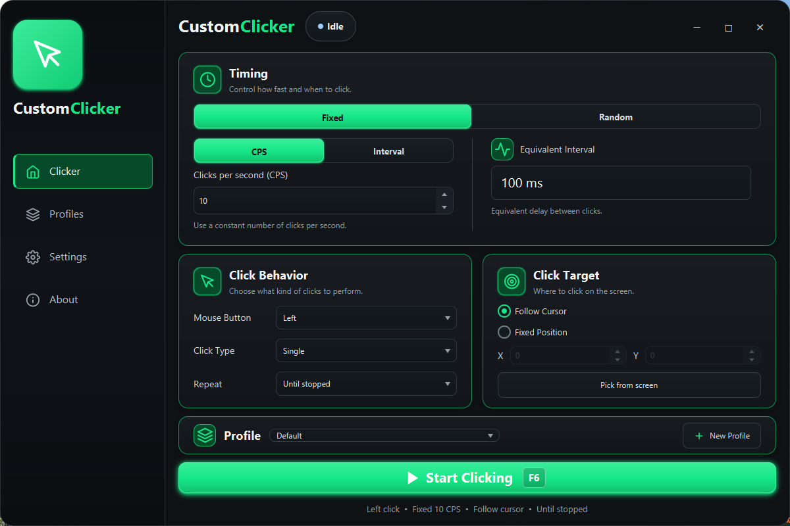
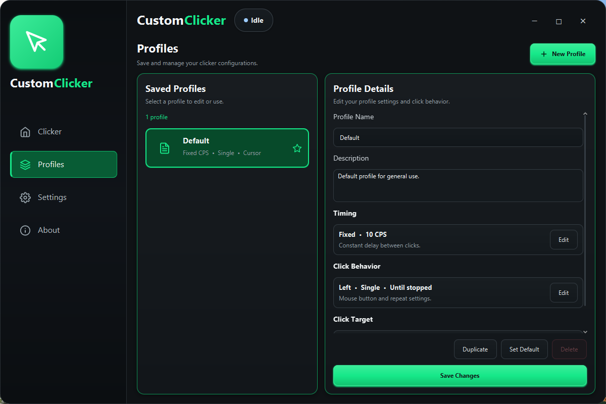
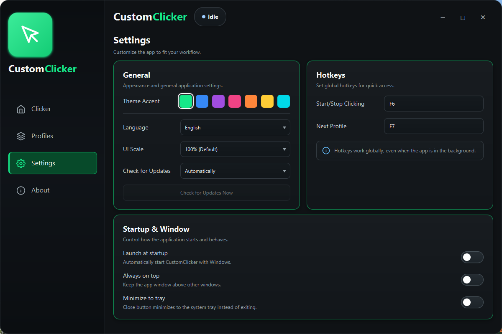
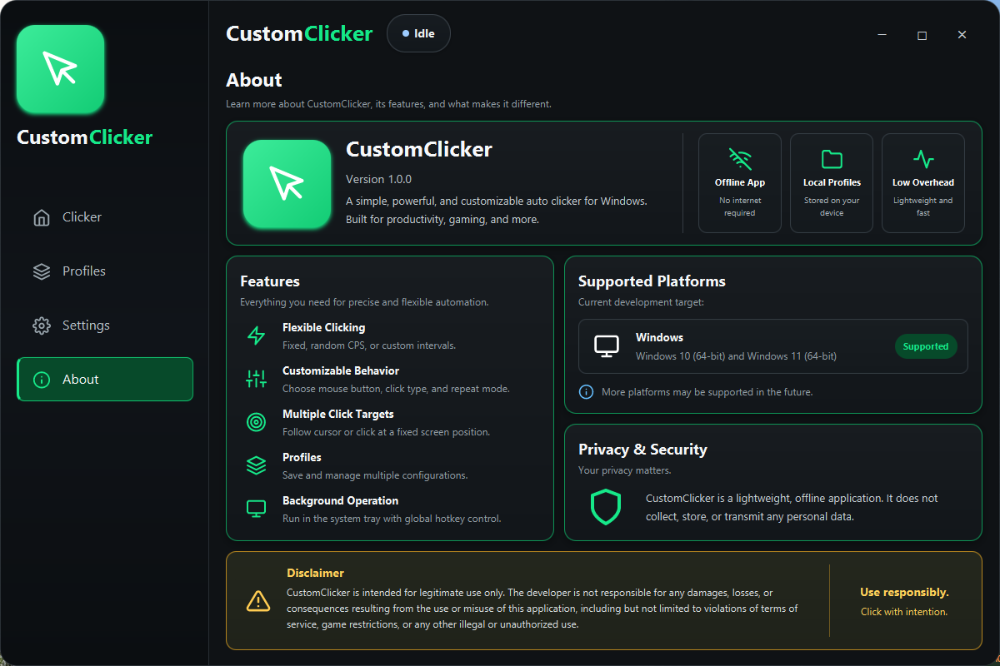

# CustomClicker

CustomClicker is a Windows auto clicker built with Java and JavaFX. Set your click speed, choose where to click, and save different setups as profiles so you don't have to configure everything again next time.



## Why I built it

There are a lot of sketchy auto clickers floating around online, and I wanted to build something I could understand and feel comfortable running on my own computer.

I also wanted to take a project all the way from an idea to an application people could actually install and use. Writing the clicking logic was only part of that. Building the interface, saving user settings, working with global hotkeys, testing things, cleaning up the code, and putting together a Windows installer all gave me a chance to build some real-world skills.

It's a learning project, but I wanted to give it the same care I'd give an application I was shipping for someone else.

## What it can do

- Use a fixed click speed or interval, or randomize the timing within a range.
- Choose left, right, or middle clicks, with single or double clicking.
- Keep clicking until stopped, or run a set number of click cycles.
- Follow the cursor or click a fixed position, with a screen-position picker.
- Create, duplicate, rename, and save profiles for different setups.
- Start and stop clicking or cycle profiles with configurable global hotkeys.
- Change the accent color and UI scale, keep the window on top, or hide it to the system tray.
- Launch with Windows through the installed application's startup setting.

The app runs offline and stores profiles and settings locally. There's no account to create, and the installer includes Java, so you don't need to install it separately.

## Download and install

CustomClicker is built for **Windows 10 and Windows 11, 64-bit (x64)**.

1. Open the [GitHub Releases page](https://github.com/1999Travis250/CustomClicker/releases).
2. Under the latest release's **Assets**, download the **CustomClicker installer EXE**. The source-code ZIP isn't the installer.
3. Run the installer and follow the setup steps.
4. Open **CustomClicker** from the desktop shortcut or Start Menu.

If no installer is listed yet, the first release hasn't been published. The installer is currently unsigned, so Windows may show an unknown-publisher or SmartScreen warning.

To uninstall, open Windows **Settings > Apps**, find **CustomClicker**, and choose **Uninstall**.

## Getting started

1. On the **Clicker** page, choose **Fixed** or **Random** timing. CPS means clicks per second; an interval is the delay between clicks in milliseconds.
2. Choose your mouse button, single or double clicking, and whether to keep going or stop after a fixed amount.
3. Choose **Follow Cursor**, or select **Fixed Position** and enter coordinates. **Pick from screen** lets you choose the location directly; press **Escape** to cancel the picker.
4. Press **F6** or click **Start Clicking**. Press F6 again to stop.

With double clicking, the repeat amount counts double-click cycles. For example, a repeat amount of 10 produces 20 individual clicks.

### Hotkeys

| Default key | Action |
| --- | --- |
| **F6** | Start or stop clicking |
| **F7** | Select the next profile |

These work while another window has focus, too. To change one, open **Settings**, click its hotkey field, and press a function key from **F1 to F12**. Press **Escape** to keep the previous assignment. Each action needs its own key.

### Saving a setup

Configure the clicker, then click **New Profile**. On the **Profiles** page, give it a name and an optional description, then click **Save Changes**.

To update an existing profile, select it, adjust its configuration on the Clicker page, then return to Profiles and click **Save Changes**. Switching profiles doesn't automatically save edits to the current click configuration.

You can duplicate a profile as a starting point for another setup. The star marks the default profile; to delete that profile, make a different one the default first. The app remembers your last selected profile when you reopen it.

### Window and tray settings

In **Settings**, you can choose an accent color, switch between **75%**, **100%**, and **Fill Window**, and toggle **Always on top**.

With **Minimize to tray** enabled, closing the window keeps CustomClicker running in the background. Double-click its tray icon or choose **Open CustomClicker** to bring it back. Choose **Exit CustomClicker** from the tray menu to fully close it and stop clicking.

Use **Check for Updates Now** in Settings to compare your version with the latest GitHub release. If an update is available, you can open its download page. **Automatically** checks once at launch and only notifies you when a newer version is available; **Manually** and **Never** skip the launch check. You can still use the button with either option. Your update preference is saved. Updates are downloaded and installed manually.

Update checking is available starting with **v1.1.0**. If you have **v1.0.0**, download
the latest installer from GitHub Releases and run it to upgrade. Close CustomClicker
first, including its tray icon, and use the same installation directory. Your saved
profiles and settings stay in their existing application data folder.

## More screenshots

<details>
<summary>Profiles — saved setups and configuration details</summary>



</details>

<details>
<summary>Settings — appearance, hotkeys, and window preferences</summary>



</details>

<details>
<summary>About — application details and supported platforms</summary>



</details>

## Where your settings live

Profiles and application settings are saved here:

```text
%APPDATA%\CustomClicker\customclicker-data.json
```

Your settings aren't included in the installer or shared with other users. If you want to back them up, fully exit the app and copy that file somewhere safe.

## Running from source

For development, you'll need **JDK 25** and **Maven**. From the directory containing `pom.xml`:

```powershell
mvn test
mvn javafx:run
```

The app uses JavaFX for the interface, Gson for JSON persistence, JNativeHook for global hotkeys, and Ikonli for icons. Windows installer build details are in [PACKAGING.md](PACKAGING.md).

## Feedback

If something breaks or you have an idea for an improvement, [open an issue](https://github.com/1999Travis250/CustomClicker/issues). For bugs, include your Windows version, what you were doing, and the steps needed to reproduce it.

Please use CustomClicker responsibly and check the rules of any application or service you're using it with.
